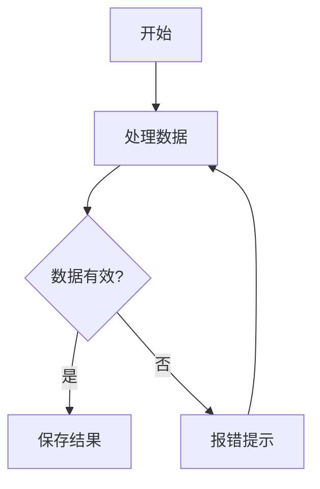
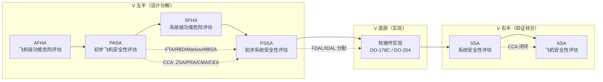

# Mermaid 流程图渲染测试

本文档验证 mermaid 代码块渲染为流程图（内置离线引擎；如已放入 `vendor/mermaid/mermaid.min.js` 则自动使用完整 mermaid）。

## 简单流程图



## V 模型（LR + 子图 + 虚线）



## 不应渲染的场景

普通代码块保持原样（带语法高亮和 Copy 按钮）：

```mermaid
这段其实是文本说明，不是合法流程图 —— 若引擎无法解析会回退显示源码
```

```python
# 普通代码块不受影响
def hello():
    return "world"
```
